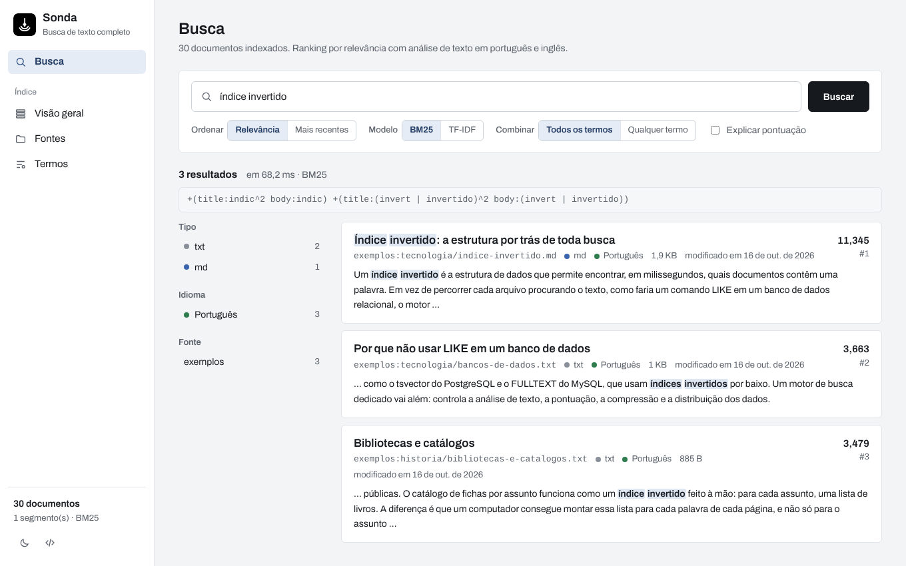
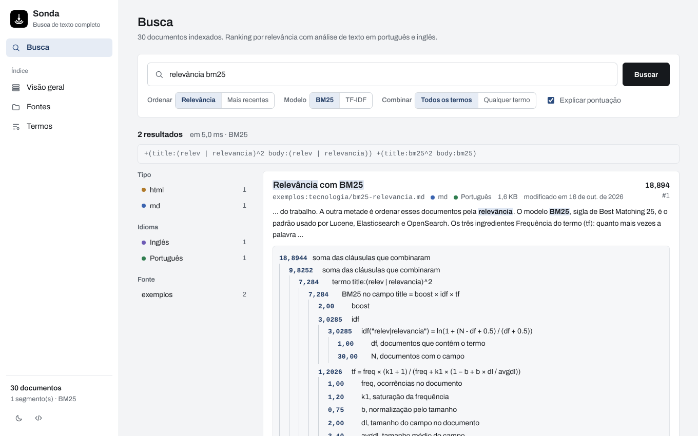
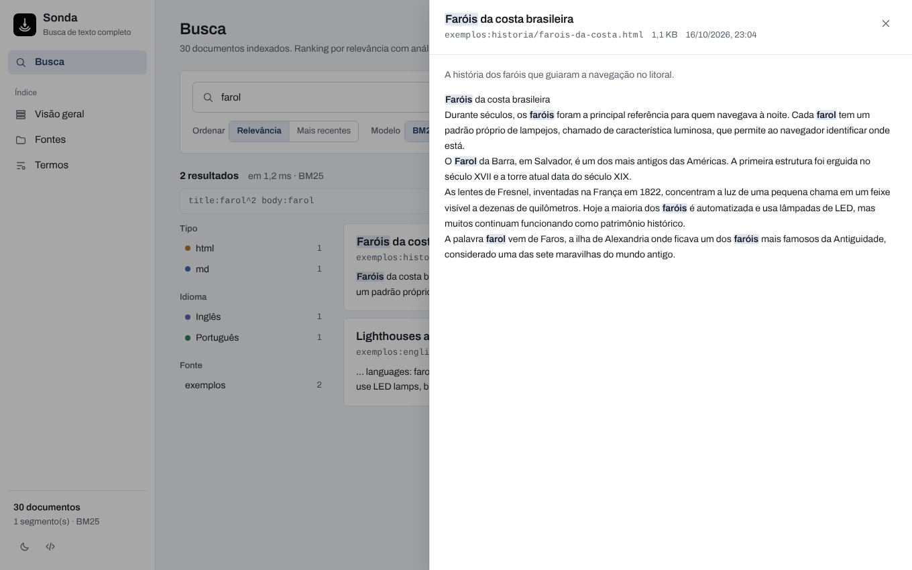
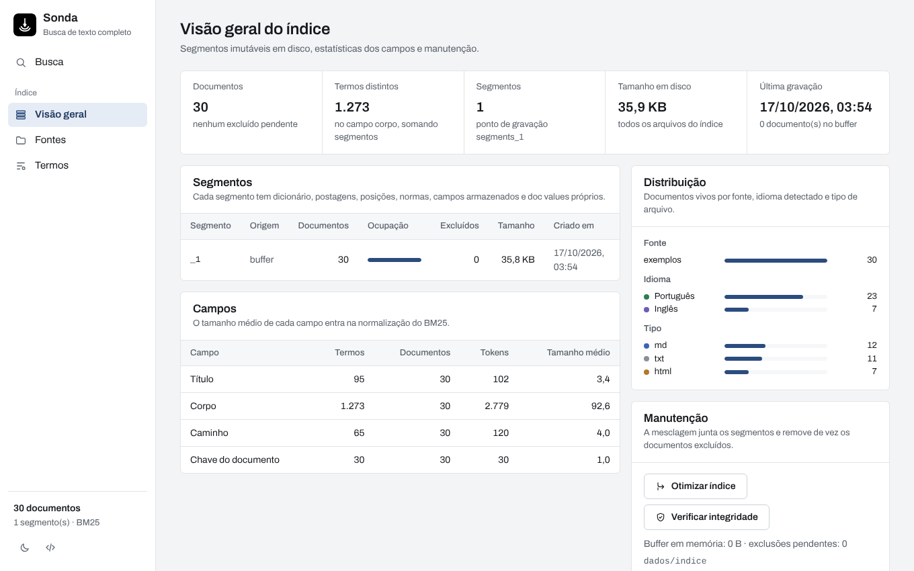
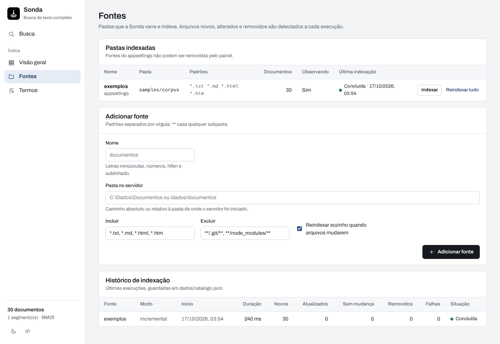
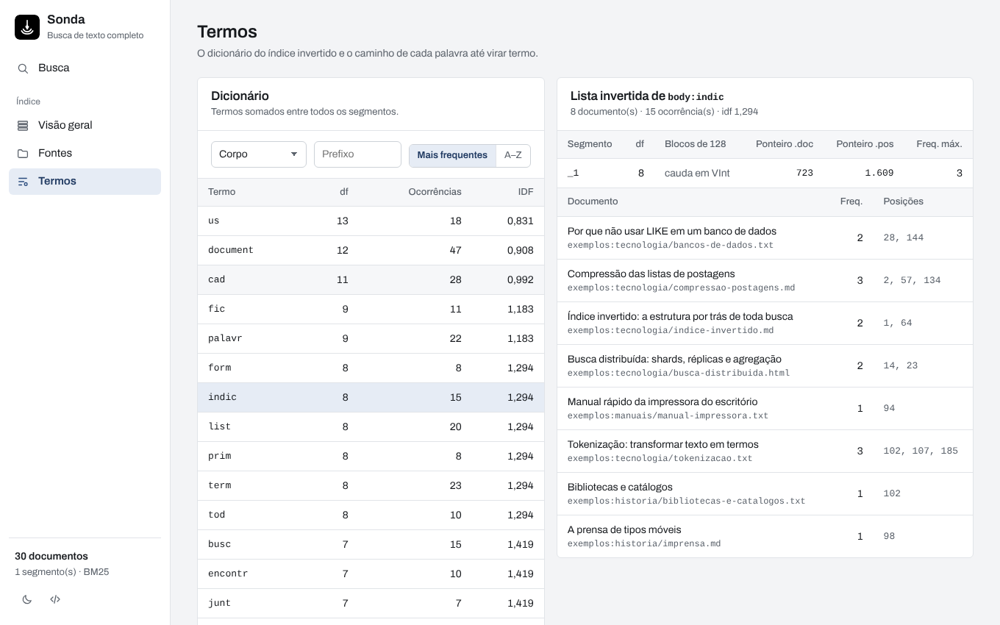
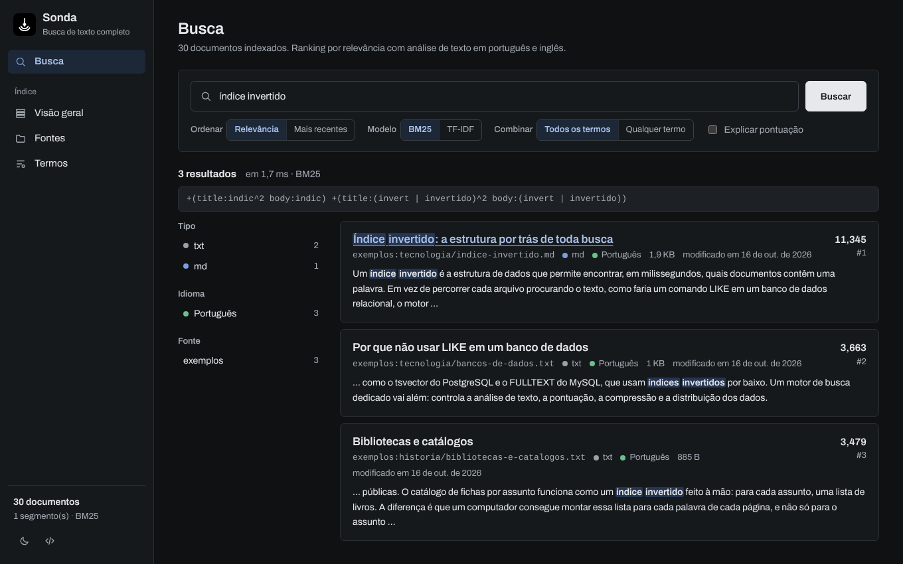
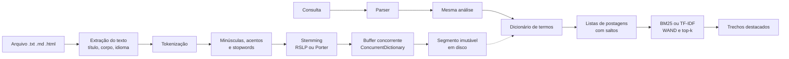
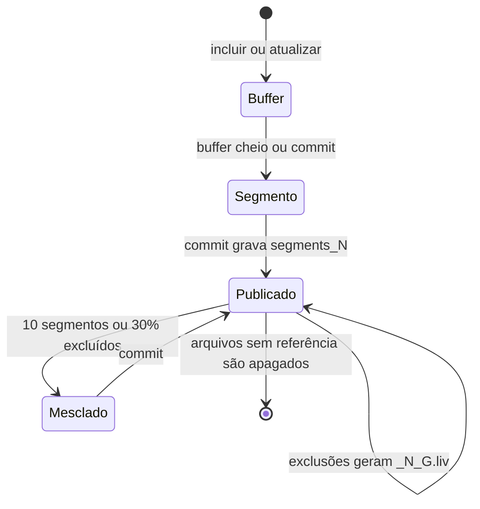
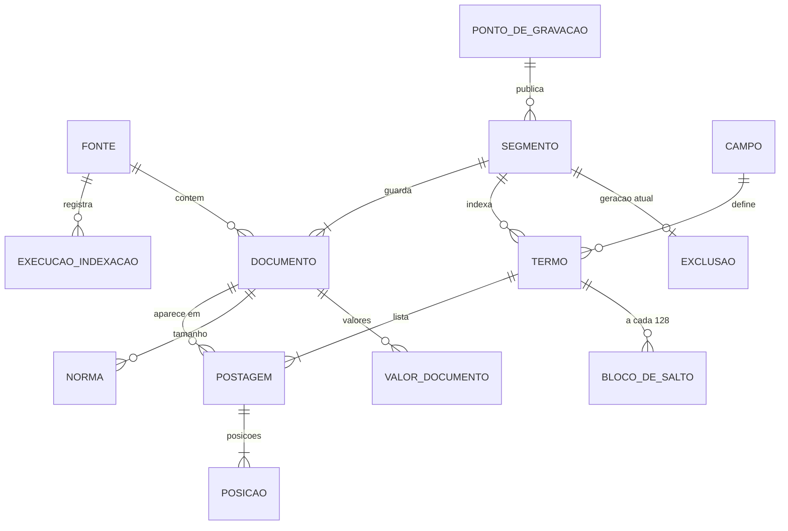

<p align="center">
  
</p>

<h1 align="center">Sonda<br><sub><sup><sup><sub>Copyright (©) 2026 Erik Pimenta</sub></sup></sup></sub></h1>

<p align="center">
  Motor de busca de texto completo escrito do zero em C#, no estilo Lucene e Elasticsearch, que indexa pastas inteiras de .txt, .md e .html em paralelo.<br>
  Tokenização, stemming em português e inglês, índice invertido binário em disco e ranking por BM25 ou TF-IDF, sem banco SQL e sem nenhum <code>LIKE '%texto%'</code>.
</p>

<p align="center">
  C# · .NET 10 · Task Parallel Library · Channels · ConcurrentDictionary · FileStream e RandomAccess · Brotli · ASP.NET Core · Server-Sent Events · HTML, CSS e JS puros · xUnit · Docker · GitHub Actions
</p>

---

> **Manual completo:** [`Manual-Sonda.pdf`](Manual-Sonda.pdf) explica as ferramentas usadas, instalação, configuração, cada tela do painel, a sintaxe de busca, a linha de comando, a API, desempenho, testes, a automação diária e solução de problemas, passo a passo (cópia em [`docs/`](docs/Manual-Sonda.pdf)).

> **Banco de dados:** [`Banco-de-Dados-Sonda.pdf`](Banco-de-Dados-Sonda.pdf) traz o diagrama de relacionamentos que o índice deve seguir, todas as estruturas com campos, tipos e chaves, o formato binário de cada arquivo e as regras de consistência (cópia em [`docs/`](docs/Banco-de-Dados-Sonda.pdf)).

<p align="center">
  
</p>

## O que a Sonda faz

- **Análise de texto própria:** tokenização Unicode, minúsculas, remoção de acentos, stopwords em português e inglês, stemming **RSLP** (português) e **Porter** (inglês) e detecção automática do idioma de cada documento.
- **Índice invertido em disco:** segmentos imutáveis gravados com `FileStream` num formato binário próprio: codificação delta, inteiros de tamanho variável, blocos de 128 empacotados em bits, tabelas de saltos, campos armazenados comprimidos com Brotli e checksum CRC32 em todos os arquivos.
- **Indexação paralela:** uma tarefa varre as pastas e vários consumidores da Task Parallel Library (`Parallel.ForEachAsync` sobre um `Channel` limitado) analisam os arquivos ao mesmo tempo e gravam num buffer compartilhado em `ConcurrentDictionary`.
- **Relevância:** BM25 (padrão) ou TF-IDF clássico, peso 2 para o título, estatísticas globais entre segmentos e explicação de cada pontuação.
- **Consultas:** todos ou qualquer termo, frases exatas e com distância, prefixos, busca aproximada com distância de edição, exclusão, grupos, campos, pesos e filtros por tipo, idioma e fonte.
- **WAND:** nas buscas por qualquer termo, documentos que não têm como entrar no top 10 são pulados.
- **Indexação incremental:** arquivos sem mudança são pulados, alterados são substituídos e removidos saem do índice. Pastas podem ser observadas e reindexadas sozinhas.
- **Commit atômico, mesclagem em segundo plano** e verificação de integridade de todos os arquivos.
- **Painel web**, **API REST** e **linha de comando** (`sonda`), todos sobre o mesmo motor.
- **Sem dependências externas no motor:** tokenizador, stemmers, extrator de HTML, codecs, CRC32, parser de consultas, pontuação, WAND e destaque de trechos foram escritos do zero.

## Interface

Painel para pesquisar, entender a pontuação e enxergar o índice por dentro:

- **Busca** com facetas, trechos destacados, consulta interpretada, alternância BM25/TF-IDF e explicação da pontuação em árvore.
- **Visão geral** com segmentos, campos, distribuição por fonte, idioma e tipo, mesclagem e verificação de integridade.
- **Fontes** com cadastro de pastas, progresso da indexação em tempo real por Server-Sent Events e histórico.
- **Termos** com o dicionário do índice, a lista invertida de cada termo (ponteiros, blocos e posições) e um analisador que mostra o caminho de cada palavra até virar termo.
- Mesma paleta do Doca: fundo cinza-claro, painéis brancos, bordas finas e um único destaque, o azul-marinho `#2B4C7E`, no menu ativo, nas barras, nos termos encontrados e no foco do teclado.
- A marca, um prumo de sondagem descendo com duas ondas de sonar, é sempre em preto e branco.
- Tema escuro com os mesmos tons, ajustados para fundo escuro, e layout para celular.
- Fonte [Archivo](https://github.com/Omnibus-Type/Archivo), incluída no projeto (sem CDN).

| Cor | Uso |
|---|---|
| `#F3F4F6` | Fundo das páginas |
| `#FFFFFF` | Painéis, tabelas e formulários |
| `#E1E4E8` | Bordas e divisórias |
| `#5B626B` | Textos de apoio |
| `#16191D` | Texto e botões principais |
| `#2B4C7E` | Destaque, termos encontrados e foco |

| Tela | |
|---|---|
|  |  |
|  |  |
|  |  |

## Como a busca funciona



1. **Extração:** HTML perde scripts, estilos e comentários; o `<title>` e o `lang` são aproveitados. Markdown perde a marcação e o primeiro `#` vira título. Texto puro usa a primeira linha como título.
2. **Análise:** a mesma sequência roda na indexação e na consulta, então quem procura "páginas indexadas" encontra "Indexaram muitas páginas". As palavras descartadas continuam contando posição, para as frases respeitarem a distância original.
3. **Buffer em memória:** cada documento recebe um número com `Interlocked.Increment` e seus termos entram num `ConcurrentDictionary` compartilhado. Quando o buffer passa do limite, ele é trocado por um novo em microssegundos e gravado em disco enquanto as outras threads continuam indexando.
4. **Segmento:** dicionário com prefixos compartilhados, postagens em blocos de 128, posições, normas de 1 byte, valores por documento e campos armazenados. Tudo com cabeçalho e rodapé com CRC32.
5. **Commit:** o `segments_N` é gravado como `pending_segments_N`, sincronizado no disco e renomeado. Se o processo cair antes disso, o índice reabre no estado anterior.
6. **Busca:** cada termo vira uma lista ordenada; conjunções avançam com tabelas de saltos e disjunções usam WAND. Um heap mínimo guarda o top-k e os trechos são montados reanalisando o texto armazenado.

### Ciclo do índice



## Relevância

| Modelo | Fórmula | Observação |
|---|---|---|
| BM25 (padrão) | `idf × freq × (k1 + 1) / (freq + k1 × (1 − b + b × dl / avgdl))` com `idf = ln(1 + (N − df + 0,5) / (df + 0,5))` | Satura a frequência e normaliza pelo tamanho do campo. k1 = 1,2 e b = 0,75 |
| TF-IDF clássico | `√freq × idf² × 1/√dl` com `idf = 1 + ln((N + 1) / (df + 1))` | Sem saturação, para comparação |

O título recebe peso 2, as estatísticas (N, df e tamanho médio) são somadas entre todos os segmentos e a explicação de cada resultado mostra a conta inteira.

## Desempenho

`sonda benchmark` com 100 mil documentos sintéticos de 80 a 600 palavras e 1.000 consultas, numa máquina com **2 vCPUs** a 2,1 GHz:

| Medida | Resultado |
|---|---|
| Indexação | 18,8 s · **5.333 documentos/s** · 16,3 MB/s de texto |
| Mesclagem para 1 segmento | 9,6 s |
| Tamanho do índice | 176,9 MB com o texto completo armazenado |
| Qualquer termo, contagem exata e facetas | p50 2,98 ms · p95 6,36 ms · 30.809 documentos avaliados |
| Qualquer termo, top 10 com **WAND** | p50 2,24 ms · p95 3,61 ms · **756 documentos avaliados** |
| Todos os termos, com saltos | p50 2,17 ms · p95 4,45 ms |

## Como rodar

Pré-requisito: **.NET SDK 10** (recomendado) **ou Docker**.

```bash
git clone https://github.com/ravelroot/Inverted-Index-Search-Engine.git
cd Inverted-Index-Search-Engine
```

**Windows:** dê dois cliques em `iniciar.cmd`.
**Linux / macOS:** `./iniciar.sh`

O script cria o `.env` a partir do `.env.example`, gera uma chave de acesso aleatória, compila e inicia o servidor (ou sobe o Docker, se o SDK não estiver instalado) e abre o navegador em **http://localhost:8080** com os 30 documentos de exemplo já indexados. A chave aparece no terminal e fica só no seu `.env`.

### Com Docker

Coloque em `SONDA_DOCUMENTOS`, no `.env`, a pasta que você quer indexar e rode:

```bash
docker compose up -d --build
```

A pasta entra no contêiner como somente leitura, o índice fica no volume `sonda-dados` e a porta é presa a `127.0.0.1`.

### Sem os scripts

```bash
dotnet build src/Sonda.Server -c Release
dotnet src/Sonda.Server/bin/Release/net10.0/Sonda.Server.dll
```

Para indexar suas próprias pastas, cadastre-as na tela **Fontes** ou em `Sonda:Sources` no [`appsettings.json`](src/Sonda.Server/appsettings.json).

## Linha de comando

```bash
dotnet run --project src/Sonda.Cli -- indexar C:\Documentos --fonte documentos
dotnet run --project src/Sonda.Cli -- buscar "índice invertido" --explicar
```

| Comando | Função |
|---|---|
| `indexar <pasta>` | Indexa a pasta. `--fonte`, `--incluir`, `--excluir`, `--completo`, `--paralelismo`, `--idioma auto\|pt\|en\|nenhum`, `--ram` |
| `buscar "consulta"` | Busca. `--top`, `--pagina`, `--tfidf`, `--ou`, `--explicar`, `--recentes`, `--tipo`, `--fonte`, `--json` |
| `estatisticas` | Documentos, segmentos, campos, tamanho e distribuição |
| `termos` | Dicionário de um campo. `--campo`, `--prefixo`, `--limite`, `--frequencia` |
| `postagens <termo>` | Lista invertida de um termo, com ponteiros, blocos e posições |
| `analisar "texto"` | Tokenização, stopwords e radicais RSLP e Porter |
| `otimizar` | Mescla os segmentos e remove os excluídos |
| `verificar` | Confere o CRC32 de todos os arquivos do índice |
| `remover-fonte <nome>` | Remove do índice os documentos de uma fonte |
| `benchmark` | Gera um corpus sintético e mede indexação e consultas. `--docs`, `--consultas` |

Comandos de leitura funcionam com o servidor aberto. Os de escrita exigem que ele esteja parado, porque só um processo grava no índice (`write.lock`).

## Sintaxe de busca

| Consulta | Resultado |
|---|---|
| `motor busca` | Todos os termos (padrão), com stemming |
| `motor OR busca` · `motor OU busca` | Qualquer um dos termos |
| `bm25 -tfidf` · `bm25 NOT tfidf` | Exclui documentos com o termo |
| `+motor busca` | `motor` obrigatório, `busca` só aumenta a pontuação |
| `"índice invertido"` | Frase exata |
| `"motor relevância"~4` | Frase com até 4 posições de folga |
| `busc*` | Prefixo |
| `algoritimo~` · `algoritimo~1` | Busca aproximada, tolera erros de digitação |
| `(feijoada OR moqueca) receita^2` | Grupos e peso extra |
| `titulo:farol` · `corpo:` · `caminho:` | Busca só no campo |
| `tipo:html` · `idioma:en` · `fonte:exemplos` | Filtros que não mudam a pontuação |

Acentos e maiúsculas não importam. Se nenhum documento tiver todos os termos, a busca é ampliada sozinha para qualquer um deles e o painel avisa.

## Configuração

As opções ficam em `src/Sonda.Server/appsettings.json` e podem ser sobrescritas por variáveis de ambiente (`Sonda__Search__Similarity=TFIDF`). O [`.env.example`](.env.example) lista as variáveis dos scripts e do Docker; o `.env` nunca vai para o Git.

| Seção | Principais opções | Padrão |
|---|---|---|
| `Sonda:IndexPath` · `DataPath` | Pasta do índice e do catálogo | `dados/indice` · `dados` |
| `Sonda:Analysis` | `Language` (`auto`, `pt`, `en`, `nenhum`), `DefaultLanguage`, `StopWords`, `FoldAccents` | `auto`, `pt`, ligados |
| `Sonda:Indexing` | `RamBufferMb`, `Parallelism`, `MaxFileMb`, `StoreBody`, `MergeFactor`, `AutoMerge`, `IndexOnStartup`, `WatchDebounceSeconds` | 128, todos os núcleos, 32, sim, 10, sim, sim, 3 |
| `Sonda:Search` | `Similarity`, `K1`, `B`, `TitleBoost`, `DefaultOperator`, `MaxResultWindow`, `SnippetLength` | BM25, 1,2, 0,75, 2, And, 1000, 240 |
| `Sonda:Api` | `ApiKey`, `ProtectReads`, `AllowedOrigins` | sem chave, não, sem CORS |
| `Sonda:AllowedRoots` | Pastas dentro das quais novas fontes podem ser cadastradas | qualquer pasta |
| `Sonda:Sources` | Fontes fixas: `Name`, `Path`, `Include`, `Exclude`, `Watch` | `exemplos` em `samples/corpus` |

## API

Com `Sonda:Api:ApiKey` definido, as rotas que alteram o índice exigem o cabeçalho `X-Sonda-Key`.

| Método | Rota | Função |
|---|---|---|
| GET | `/api/busca?q=&pagina=&tamanho=&ordem=&similaridade=&operador=&explicar=&tipo=&idioma=&fonte=` | Busca com trechos, facetas e explicação |
| GET | `/api/documentos/{chave}?q=` | Documento completo com destaques (chave em Base64 URL) |
| GET | `/api/indice` | Estatísticas, segmentos e campos |
| POST | `/api/indice/otimizar` · `/api/indice/verificar` | Mesclagem forçada e verificação de checksums |
| GET | `/api/termos?campo=&prefixo=&ordem=` · `/api/termos/postagens?campo=&termo=` | Dicionário e lista invertida |
| GET | `/api/analise?texto=` | Análise de texto passo a passo |
| GET · POST · DELETE | `/api/fontes` · `/api/fontes/{nome}` | Lista, cadastra e remove fontes |
| POST | `/api/fontes/{nome}/indexar?modo=incremental\|completa` | Agenda uma indexação |
| GET · POST | `/api/indexacao` · `/api/indexacao/cancelar` | Fila e cancelamento |
| GET | `/api/execucoes` | Histórico de indexação |
| GET | `/api/eventos` | Server-Sent Events: `progresso`, `fila`, `execucao`, `indice` |
| GET | `/api/info` · `/health` | Informações e sonda de vida |

Erros seguem o padrão Problem Details (RFC 9457):

```json
{ "title": "Consulta inválida.", "status": 400, "detail": "Faltou fechar um parêntese." }
```

## Banco de dados

O "banco" da Sonda é o próprio índice invertido em `dados/indice`, mais o catálogo `dados/catalogo.json` com as fontes e o histórico.



| Arquivo | O que guarda |
|---|---|
| `segments_N` | Ponto de gravação: geração e lista de segmentos válidos |
| `_N.si` | Segmento: documentos, origem, campos e arquivos |
| `_N.tip` · `_N.tim` | Índice em memória e dicionário de termos com prefixos compartilhados |
| `_N.doc` · `_N.pos` | Postagens em blocos de 128 com tabela de saltos, e posições |
| `_N.nrm` | Tamanho de cada campo em 1 byte, usado no BM25 |
| `_N.fdt` · `_N.fdx` | Campos armazenados comprimidos com Brotli |
| `_N.dv` | Valores por documento para facetas e ordenação |
| `_N_G.liv` | Mapa de bits dos documentos excluídos |

O diagrama completo, com todos os campos, tipos, chaves, o formato binário de cada arquivo e as regras de consistência, está em [`Banco-de-Dados-Sonda.pdf`](Banco-de-Dados-Sonda.pdf).

## Estrutura

```
src/
  Sonda.Analysis/   tokenizador, remoção de acentos, stopwords, stemmers RSLP e Porter, detecção de idioma e extração de HTML e Markdown
  Sonda.Storage/    entrada e saída binária, CRC32, blocos FOR, normas e formatos de dicionário, postagens, campos, doc values e commit
  Sonda.Engine/     buffer concorrente, gravação e mesclagem de segmentos, IndexWriter, consultas, BM25, TF-IDF, WAND, destaque e varredura de pastas
  Sonda.Server/     API REST, eventos em tempo real, fila de indexação, observação de pastas e painel (wwwroot)
  Sonda.Cli/        ferramenta de linha de comando sonda e benchmark
tests/
  Sonda.Tests/      testes xUnit
samples/
  corpus/          30 documentos de exemplo em português e inglês
scripts/           inicialização no Windows
docs/              imagens, manual e diagrama do banco
```

## Testes

```bash
dotnet test tests/Sonda.Tests
```

São 92 casos que provam, entre outras coisas, que a pontuação BM25 é igual à fórmula, que o Porter reproduz os exemplos do artigo original, que 6.000 documentos indexados em 8 threads com vários flushes ficam todos pesquisáveis, que o WAND devolve o mesmo top 10 da busca exaustiva, que a mesclagem preserva os resultados e remove os excluídos e que um byte alterado num arquivo é detectado pelo checksum.

A integração contínua ([`.github/workflows/ci.yml`](.github/workflows/ci.yml)) compila tudo com avisos tratados como erro, roda os testes, indexa os exemplos pela linha de comando, verifica os checksums, roda um benchmark curto e gera a imagem Docker.

## Segurança e privacidade

- O repositório não traz senhas, chaves, endereços nem dados pessoais. O `.env` é gerado na sua máquina e está no `.gitignore`, assim como a pasta `dados/`.
- Os documentos de exemplo foram escritos para o projeto; manuais e políticas são de uma empresa fictícia.
- O servidor escuta em `127.0.0.1` por padrão e o Docker prende a porta ao mesmo endereço.
- Chave de acesso comparada em tempo constante; no painel ela fica só na memória da aba.
- `Sonda:AllowedRoots` impede o cadastro de pastas fora das raízes permitidas.
- Cabeçalhos de segurança (CSP sem scripts externos nem inline, `X-Frame-Options`, `nosniff`, `Referrer-Policy`) em todas as respostas.
- O painel monta tudo com `textContent`, então trechos de documentos nunca são interpretados como HTML.
- Nada é enviado para fora: sem telemetria, sem CDN, sem chamadas externas.

## Licença

[MIT](LICENSE). Use, copie, altere e distribua à vontade. A fonte Archivo é distribuída sob a [SIL Open Font License](src/Sonda.Server/wwwroot/fonts/OFL-Archivo.txt).
